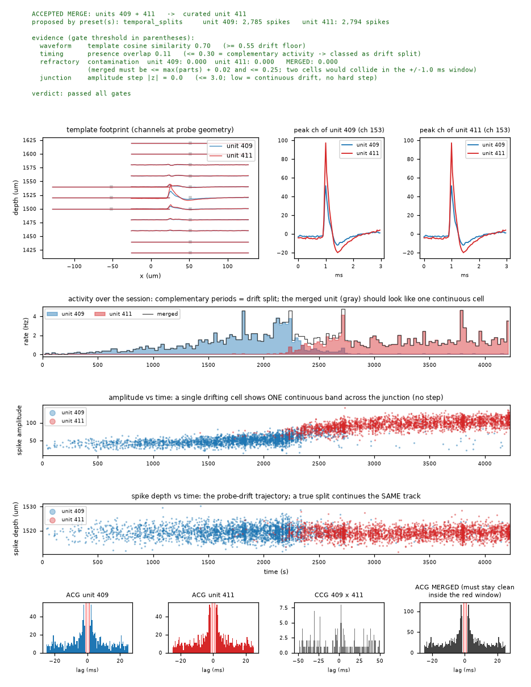
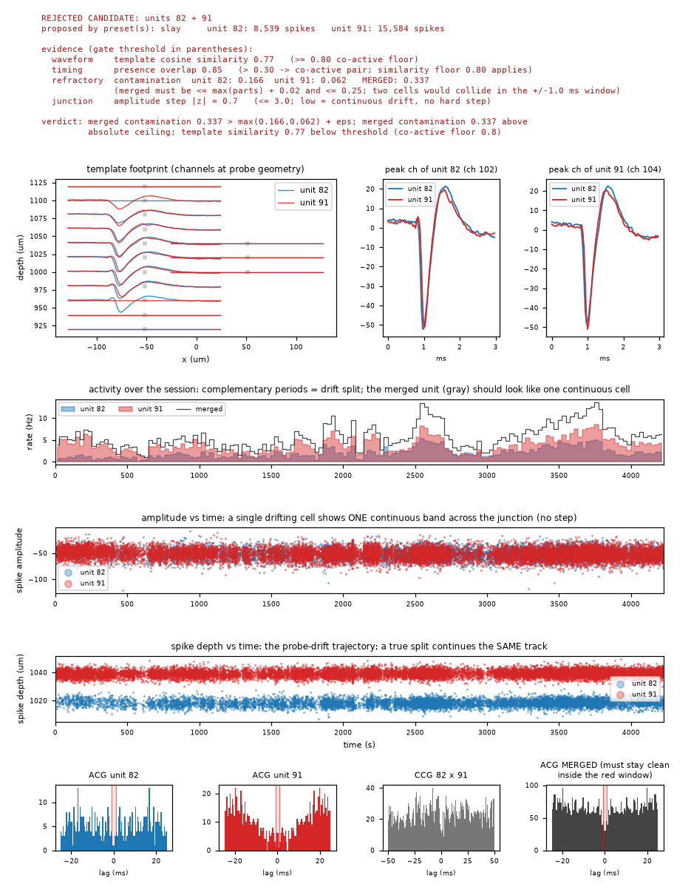

# kilosort-autocuration

**Automatic curation of Kilosort / Kilosort4 spike sorting output: reads a Kilosort
result folder and writes a curated folder in the same Kilosort/phy format.**
Drop-in: any downstream pipeline that reads Kilosort output (phy, pyapl, custom
loaders) can consume the curated folder unchanged. Designed for Neuropixels and
other high-density probe recordings; installed as the `ks-autocuration` package.

Spike sorters over-split units (drift makes one neuron look like two appearing at
different times in the session) and over-merge others, and they mislabel quality.
Manual curation in phy fixes this but does not scale and is subjective. This tool
automates the standard curation moves, composing the best published components, and
produces a QC report so every decision can be spot-checked and vetoed.

## What it does

| Stage | Method | Source |
|---|---|---|
| Evidence | `SortingAnalyzer`: waveforms, templates, amplitudes, PCs, correlograms, quality metrics (incl. IBL sliding refractory-period contamination) | [SpikeInterface](https://github.com/SpikeInterface/spikeinterface) |
| Merge candidates | union of merge presets: `temporal_splits` (drift over-splits), `similarity_correlograms`, and `slay` ([SLAy](https://doi.org/10.1101/2025.06.20.660590): NN waveform similarity + EMD cross-correlogram test) | SpikeInterface curation |
| Merge verification | conservative gate: merged refractory contamination must not exceed the worst constituent (+ε), template similarity floor, amplitude continuity across the junction | this package |
| Over-merge screen | demote-don't-split: strongly bimodal amplitude distributions (GMM, Ashman's D) → `mua` | this package |
| Labeling | ensemble of [Bombcell](https://github.com/Julie-Fabre/bombcell) (threshold + non-somatic detection), [UnitRefine](https://doi.org/10.1101/2025.03.30.645770) ML classifiers, and IBL-style metric thresholds; conservative combination | SpikeInterface curation |
| Export | Kilosort/phy-format folder + lineage + [SpikeInterface curation JSON](https://spikeinterface.readthedocs.io/en/latest/modules/curation.html) + QC report PDF | this package |

Nothing is ever deleted: noise units stay in the output labeled `noise`; absorbed
merge constituents are labeled `merged` and keep zero spikes.

## Example output

Every merge decision — accepted or rejected — gets a full evidence page in
`curation_report.pdf`. Both examples below are real pages from an NHP
temporal-cortex Neuropixels session (556 Kilosort4 clusters, 70 min).

**Accepted: a drift over-split merged back into one neuron.** Same waveform
(cosine 0.70), *complementary* activity periods (presence overlap 0.11 — unit 409
hands off to unit 411 mid-session), one continuous amplitude band and one depth
track across the junction, and a merged train with zero refractory contamination:



**Rejected: two co-active neighbors the gate kept apart.** The waveforms are
temptingly similar (cosine 0.77, just below the co-active floor) and a
similarity-only rule would merge them — but both units fire throughout the session
on two distinct depth tracks, and merging would triple refractory contamination
(0.166 / 0.062 → 0.337): two cells, not one.



On this session the pipeline accepted 1 of 11 candidate pairs, removed 101 noise
clusters by Bombcell∧UnitRefine consensus, and tightened `good` from 321 to 125
units — Kilosort4's own drift handling left little to merge, which is exactly what
a conservative gate should conclude.

## Install

```bash
pip install -e .            # core
pip install -e ".[ml]"      # + UnitRefine models / SLAy extras
```

Requires Python ≥ 3.10 and SpikeInterface ≥ 0.102 (installed automatically).

## Usage

```bash
ks-autocurate run /path/to/kilosort4 \
    --recording /path/to/continuous.dat \   # optional if params.py dat_path is valid
    --out /path/to/kilosort4_curated \      # default: sibling '<input>_curated'
    --config my_overrides.yaml              # optional, overlays configs/default.yaml
```

or from Python:

```python
from ks_autocuration import run
out = run("path/to/kilosort4", recording_path="path/to/continuous.dat")
```

The input folder is treated as strictly read-only. The raw recording is located via
`params.py` (`dat_path`) unless `--recording` is given; probe geometry is rebuilt
from `channel_positions.npy`/`channel_map.npy`, so no acquisition-system metadata is
needed. All computation caches live in `<out>_work/` (safe to delete afterwards).

## Output folder

Identical file set to the input (per-spike arrays row-aligned and subset together),
plus:

- `spike_times/clusters/templates.npy`, `amplitudes.npy`, … — curated; `spike_clusters`
  and `spike_templates` are written identically so readers of either agree
- `templates.npy` — merged units' rows replaced by spike-count-weighted averages
- `cluster_KSLabel.tsv` / `cluster_group.tsv` — final labels (`good`/`mua`/`noise`/`merged`);
  original labels preserved in `cluster_KSLabel_original.tsv`
- `cluster_labels_by_labeler.tsv` — per-labeler votes (threshold / bombcell / unitrefine)
- `lineage.json` — every old id → final id, with merge evidence
- `curation.json` — SpikeInterface curation format (replayable via `apply_curation`)
- `curation_report.pdf` — a full evidence page per merge decision, accepted AND
  rejected (probe-geometry footprint, peak-channel overlays, activity-over-time,
  amplitude & depth drift tracks, ACGs/CCG + merged-train ACG with the refractory
  window marked, all gate scores vs thresholds), plus label changes — see the
  examples above
- `run_summary.json`, `curation_config.yaml`, `curation_provenance.json`

**Unit ids:** untouched units keep their original cluster id; a merge keeps the id
of its largest constituent; absorbed ids remain in the tsvs labeled `merged`. This
keeps curated output comparable with pre-curation analyses.

## Configuration

Everything is in [`configs/default.yaml`](configs/default.yaml) (documented inline):
merge presets and gate thresholds, labeler selection and ensemble policy, metric
thresholds, export options. Pass `--config` with a partial YAML to override any
subset. The defaults are deliberately conservative: a false merge is worse than a
residual over-split.

## Vetoing decisions

Review `curation_report.pdf`. To veto a merge or a label, re-run with a config
listing the exceptions (planned: `overrides.tsv`), or edit `cluster_group.tsv` in
the output — downstream phy-convention readers honor it over `cluster_KSLabel.tsv`.

## Tests

```bash
python tests/test_synthetic.py
```

builds a ground-truth recording, injects an artificial temporal over-split, and
asserts the pipeline merges it back and exports a consistent Kilosort folder.

## Limitations

- Raw recording access is currently required (template-only mode planned).
- Multi-segment recordings are not supported (single continuous session assumed).
- No automatic splitting of over-merged units: they are demoted to `mua` instead
  (consistent with the published tools; splitting reliably requires a human or a
  re-sort).

## License

MIT (see LICENSE).
